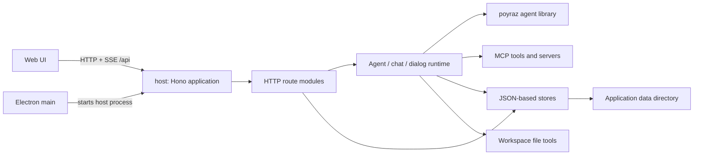

> **Status:** Updated against source on 2026-10-15 (paths, endpoints, and data files). See [Poyraz library boundary](poyraz-library-boundary.md) for a shorter responsibility overview.

# Poyraz Web Host — Architecture and Technical Overview

> This document summarizes the current behavior implemented by the `host/` service. The UI, Electron renderer, and internals of the `poyraz` agent library are out of scope; their integration points are described where relevant.

## 1. Overview

`host/` is the local HTTP backend for the Poyraz desktop application. It serves a Hono-based HTTP API, persists sessions and application settings to the filesystem, and runs agents through model providers and MCP tools. Chat responses are streamed over SSE, while session history is persisted separately.

### Responsibility boundaries

- **HTTP/API:** Reads request bodies, performs basic validation, calls the relevant store/runtime functions, and produces JSON/SSE responses.
- **Runtime:** Manages the lifecycle of the agent pool, active chats, live SSE events, and user approval/input dialogs.
- **Stores:** Read and write settings, providers, model catalog, sessions, rules, skills, memories, and MCP configuration on the filesystem.
- **Domain:** Contains transformations independent of HTTP, such as profile normalization, usage/token data, stream events, and model context.
- **Infra:** Provides shared infrastructure such as data paths, safe filesystem operations, JSON helpers, mutexes, limits, and system-prompt setup.
- **Shared:** Contains data contracts used across the host and web app, primarily in `../shared/types.ts`. Examples include `ModelProfile`, `StoredSession`, `Settings`, transcript blocks, and usage/context types.

## 2. Code structure

| Directory/file | Responsibility |
|---|---|
| `src/index.ts` | Host entry point; creates the Hono application and starts the Node server. |
| `src/http/app.ts` | CORS configuration and route-module composition. |
| `src/http/routes/` | Resource-oriented API endpoints: sessions, plan, projects, agents, providers, catalog, settings, instructions, and MCP. |
| `src/http/chat-turn.ts` | Validates and runs a single chat turn, emits events, and persists transcript data. |
| `src/http/timeline.ts` | Converts streamed text/reasoning/tool events into transcript blocks and persists partial results. |
| `src/http/request.ts` | Reads and validates HTTP bodies and chat options. |
| `src/agent/core/` | Agent, policy, workspace, and toolset definitions (`definitions/`), plus `chat.ts` and `explain.ts`. |
| `src/agent/catalog/` | Built-in agents, policies, workspaces, and prompt/instruction texts; `prompts/host-system-prompt.ts` assembles system text for the library. |
| `src/agent/workspaces/` | Workspace definitions and resolution. |
| `src/agent/runtime/` | `sessions/turn.ts` (shared session lifecycle), `agents/pool.ts` (cached instances and exclusive turn ownership), `agents/setup.ts` (workspace/agent/policy configuration), `agents/execution.ts` (library chat, summary and context calls), `events/live-chat.ts` (active-chat SSE buffer, subscriptions, replay), `events/dialogs.ts` (pending approval/input dialogs), `context/tree.ts` (sidebar tree built from the library's compiled request), `sessions/commands.ts`, `sessions/title.ts`. |
| `src/agent/tools/` | Built-in MCP server (`builtin/server.ts`), host-side bridge (`builtin/bridge.ts`), tool registry and implementations (`builtin/`), policy context, and tool labels. |
| `src/stores/` | Reads, writes, and normalizes persistent JSON data. |
| `src/plans/` | Host-side plan layer: `plan-store.ts` (markdown format, validation, atomic writes), `plan-service.ts` (session-facing tools and UI writes), `continuation.ts` (open-step rules for a turn), `open-steps-policy.ts` (those rules as a library `ContinuationPolicy`). |
| `src/tools/` | `file-access.ts` (workspace file operations) and `terminal-run.ts` (command execution). The MCP tool definitions that call them live in `src/agent/tools/builtin/`. |
| `src/domain/` | Profiles, model context, usage, and stream-event transformations. |
| `src/infra/` | Data paths, port/CORS settings, limits, filesystem/JSON helpers, and mutexes. |

## 3. Startup, development, and packaging

- `src/index.ts` serves the result of `createApp()` through `@hono/node-server`.
- By default, the host listens on `127.0.0.1:8787`, which is the development port. A valid `POYRAZ_HOST_PORT` value can override the port; invalid values fall back to the default. The packaged Electron app spawns its host with `POYRAZ_HOST_PORT=18787` so the installed app and `npm run dev` can run at the same time without a port collision.
- The CORS allowlist includes the Vite development origins and the Electron `file://` origin value (`null`). Requests from origins outside the allowlist are not granted CORS access.
- Scripts in `host/package.json`: `npm run dev` (watch mode with tsx), `npm start`, `npm run build` (tsup), `npm run typecheck` (strict TypeScript), and `npm test`.
- The host TypeScript target is ES2022/NodeNext; the build target is Node 20 ESM. `tsup.config.ts` uses `src/index.ts` as its entry point and emits `dist/index.js`.
- The root `package.json` builds the host with `build:host`; `build:desktop` combines the host, web, and Electron builds.
- In development, the Electron main process waits for the Vite and host servers to become ready on the development ports. In a packaged app, it starts `host/dist/index.js` as a Node child process with `POYRAZ_HOST_PORT=18787`, waits for the host on that port to become ready, and passes an `apiBase` parameter to the renderer. The host is included in packaged resources via `extraResources`.

## 4. HTTP API surface

Successful responses are generally JSON; chat messages and reconnections to active chats use SSE. Error responses typically use the `{ "error": "..." }` shape with an appropriate 4xx/5xx status code.

| Area | Method and path | Purpose |
|---|---|---|
| Sessions | `GET /api/sessions` | Lists session summaries. |
| | `POST /api/sessions` | Creates a session with a profile and optional reasoning/service tier. |
| | `GET /api/sessions/:id` | Retrieves a session and its transcript. |
| | `PATCH /api/sessions/:id` | Updates the title, model profile, or chat options. |
| | `DELETE /api/sessions/:id` | Stops active agent/dialog activity and deletes the session. |
| | `PUT /api/sessions/:id/policy` | Changes the policy of the session (`policyId`). |
| | `GET /api/sessions/:id/context` | Builds a context view from the session messages. |
| | `POST /api/sessions/:id/messages` | Processes a user message and streams chat events over SSE. |
| | `GET /api/sessions/:id/stream` | Replays buffered events from an active chat and subscribes to live events. Returns `404` if no chat is active. |
| | `POST /api/sessions/:id/cancel` | Cancels the chat and pending dialogs for the session. |
| | `GET /api/sessions/:id/dialogs` | Lists pending user dialogs. |
| | `POST /api/sessions/:id/dialogs/:dialogId/respond` | Submits an approval, text response, or selection. |
| Plan | `GET /api/sessions/:id/plan` | Returns the active plan with its markdown, or `{ plan: null }`. |
| | `PUT /api/sessions/:id/plan/todos/:todoId` | Sets one step's status from the UI; same lock and revision rules as the model tools. A stale revision answers `409`. |
| | `GET /api/sessions/:id/changes` | Lists the files this chat changed, one row per file with summed line counts. |
| Projects | `GET/POST /api/projects`, `PATCH/DELETE /api/projects/:id` | Lists, creates, updates, and deletes projects. |
| Agents | `GET /api/agents` | Lists the available agents. |
| Providers | `GET /api/providers` | Lists provider states. |
| | `PUT /api/providers/:kind` | Updates provider enablement, API key, and connection/model settings. |
| | `POST /api/providers/:kind/models` | Fetches provider models and updates catalog context/reasoning metadata. |
| Model catalog | `GET /api/catalog` | Lists known models. |
| | `POST /api/catalog` | Adds a model to the catalog. |
| | `DELETE /api/catalog?slug=...` | Removes a catalog entry. |
| | `PATCH /api/catalog/context-length` | Updates a model's context length. |
| Settings | `GET /api/settings`, `PUT /api/settings` | Reads and updates host/UI settings. |
| Instructions | `GET/PUT /api/rules`, `GET/PUT /api/skills`, `GET/PUT /api/memories` | Manages agent rules, skills, and memory records. |
| MCP | `GET/PUT /api/mcp` | Reads and writes MCP server configuration and state. |
| | `PUT /api/mcp/builtin` | Enables or disables the built-in MCP server. |

The shared provider kinds are `ollama`, `llamacpp`, `openai`, `groq`, `gemini`, and `openrouter`. `ollama` and `llamacpp` are classified as local providers; chat/model-discovery flows check for an API key for the other providers.

## 5. Chat-turn and event flow

1. `POST /api/sessions/:id/messages` loads the session and validates that the message is non-empty and within `MAX_MESSAGE_CHARS`. It checks that a model is selected, the provider is enabled, and—unless it is a local provider—an API key is configured.
2. `startSessionTurn` reserves an exclusive turn through `acquireAgentTurn()` before asynchronous preparation. A competing turn receives `409`. The turn handle owns cancellation, including parent abort linking, until persistence and cleanup finish.
3. The user message is added to the session transcript; the first message becomes the session title. Command expansion and agent-history replay are prepared, and the session is saved.
4. `agents/setup.ts` uses the `AgentBuilder`/`Agent` mechanism from the `poyraz` library. The profile, API key, reasoning effort, service tier, instructions, skills, and current MCP tools are supplied during agent setup.
5. Text, reasoning, tool call/result, context-usage, and lifecycle events arrive as `HostStreamEvent` values. `sessions/turn.ts` applies them to the transcript timeline and publishes them to the live chat. `chat-turn.ts` only adapts HTTP to the shared lifecycle.
6. The message POST connection is only one SSE subscriber. If it disconnects, the chat is not cancelled; `events/live-chat.ts` keeps events in memory. The client can use `GET .../stream` to receive events buffered for that turn and continue with the live stream. Cancellation is performed separately through `POST .../cancel`.
7. When a plan tool result carries a plan snapshot, the turn publishes `plan.updated` in addition to the tool result, and the transcript block keeps the snapshot for the card.
8. An agent-mode turn that ends with pending or in-progress todos continues in the same turn at most twice (`Open steps: t2, t3. Finish them or mark blocked/cancelled with a note.`). The library runs that loop through the `ContinuationPolicy` the host attaches in `agents/setup.ts` (`maxContinuations: 2`); the policy only decides. After that the open list is handed back (`ContinuationOutcome.reason === 'open-steps-handoff'`, then `plan.updated`). A cancel, a disconnect with no stream subscriber left, plan mode, or a closed plan ends the loop. After every summarization one `Plan 2/5, next t3` line is appended to the end of the summary message (`Summarization({ onSummarized })`), also when the summary happens in the middle of a turn.
9. Completed, cancelled, and partial results are written to the session file. Usage, context, and duration fields are updated as appropriate.

The live SSE replay buffer is process-local memory. If the application process exits, the event queue for an in-progress turn is not persisted. The session transcript is stored separately and survives independently of the live stream.

### Library wiring (poyraz 1.0)

`agents/setup.ts` builds every agent with explicit builder sections, because poyraz 1.0 ships every feature off:

- `Summarization({ enabled, thresholdRatio, prefix, prompt, onSummarized })`. `onSummarized` returns the plan line (`readPlanSummaryLine`), which the library appends to the end of the summary message; no plan, no line. The prefix and prompt retain their pre-1.0 localized wording in `domain/summary.ts`, so stored summaries are still recognized.
- `MaxToolRounds(n)` from the policy row. The budget now covers the whole `agent.chat` call, continuations included. The policy handed to the library carries the same number as `maxToolRounds`.
- `Mcp({ toolPrefix: 'mcp_' })` (prefix only, the host connects MCP itself), the host-owned `createMcpClientManager({ toolPrefix })` in `stores/mcp-store.ts`, and the built-in bridge all take `HOST_MCP_TOOL_PREFIX` from `tools/builtin/identity.ts`. The library files exactly the schemas with that prefix under the `mcp` context category. `mergeExternalTools` returns the names that replaced an existing tool; the host logs them.
- `Logging({ level: WARN, chatDebugLog: true, source: 'http' })`. Debug logs are written only when a log directory is configured (the host configures none), the same as before.
- `Continuation(...)` only for policies whose row has `loop: continue-open-steps`.
- Policy: `policyForId` filters the tools through the single `explain()` and hands the library `allowedTools` (a third-party MCP server whose tools all pass is written as one `mcp_<server>__*` pattern, a partly visible one and the host's own `mcp_xeck__*` tools by exact name), `deniedTools` (the row's `deny`, prefixed) and `maxToolRounds`. Third-party tools carry no label, so a row's `allow.mcp` list is not applied to them (pre-existing behavior of `explain()`).
- Runtime values: reasoning effort, service tier, context window and round budget are not part of the agent's pool key. A reused agent gets `setReasoning`, `setServiceTier`, `setContextWindow` and `setMaxToolRounds` before each turn, so changing them keeps the agent, its history and the provider cache. The window comes from the library's `resolveContextWindow` (catalog override, then the provider's cached lengths, then the static OpenAI table; a value under 1000 tokens counts as unknown). A change of model, key, policy, prompt, rules, skills or tool set still rebuilds the agent.
- MCP connections: `stores/mcp-store.ts` calls `sync(defs)` of its host-owned `createMcpClientManager` on every refresh and config change. Only new, changed or removed servers are touched (definitions are compared by value), a failed server is not retried until its definition changes, and concurrent calls queue inside the manager. It is the manager's `sync`, not `agent.syncMcp`, because the latter gives each session agent its own connections; the host connects once and merges the tools.
- No-tool models: a turn that fails with `isToolUseUnsupportedError` (OpenRouter, OpenAI, Groq, llama.cpp wordings) is retried once without tools, and the model is remembered as tool-less until restart.
- Tool result size: the host does not set `ToolResultMaxChars/Bytes`. The built-in server bounds its own results to 20,000 bytes while keeping them valid JSON (`builtin/results.ts`), which the file, terminal and plan cards parse; a library cut would end with a `[truncated: ...]` note and break that. Third-party MCP results are therefore still unbounded.
- Repair, same-tool breaker, progress tools and rate-limit waiting are not enabled.

Context meter: the library compiles the request and measures it, the host only reads. During a turn each `context.usage` event carries `parts` from `agent.getContextMeterReal()`; at the end of a turn, after an abort and after a summary the stored `contextParts` come from the same meter (the estimate when no request has completed, e.g. right after a summary). The ten categories are `system`, `tools`, `rules`, `skills`, `mcp`, `summary`, `conversation`, `toolCalls`, `toolResults`, `providerMeta`. `GET /api/sessions/:id/context` and the backfill for sessions that have usage but no breakdown compile the request on a throwaway agent (`inspectContext`), never the pooled one, so reading cannot disturb a running turn. The sidebar tree therefore lists only the tools the policy lets through. Sessions stored with the old seven-key breakdown read as zero for the new keys.

## 6. Persistence and data model

`resolveDataDir()` uses `APPDATA/Xeck` on Windows and `Xeck` under the user's home directory otherwise. Exact file paths are defined in `src/infra/data-dir.ts`.

| File/directory | Data |
|---|---|
| `settings.json` | Default profile, workspace, access, and UI/agent preferences. |
| `providers.json` | Provider configuration. |
| `catalog.json` | Model catalog and model metadata. |
| `mcp.json` | MCP server configuration. |
| `memories.json` | Memory records. |
| `projects.json` | Project records. |
| `rules/`, `skills/` | Rule and skill files; legacy `rules.json`/`skills.json` paths are also present in the infrastructure. |
| `sessions/index.json` | Session summaries and list index. |
| `sessions/<uuid>.json` | One session's transcript, agent replay history, profile, policy id, active plan slug, and usage information. |
| `sessions/<uuid>/plans/<slug>.plan.md` | One session's plan: front matter (`name`, `revision`, `todos`) plus the free markdown body with the generated todo block. |

The store layer supplies defaults when JSON files are missing and normalizes stored values. The settings and session stores use mutexes to serialize concurrent file updates, and `src/infra/data-lock.ts` is the mutex both the settings routes and the plan store serialize on. Sessions are identified by UUID; transcript messages keep UI presentation blocks separate from the agent replay history.

Plan files are written with a same-directory temporary file and `rename`, so a reader never sees a partial plan. Every write raises `revision`; a write carrying a stale or missing `expectedRevision` is rejected with a message asking the model to call `plan_read` first, because the file may have been edited by hand. Plan writes never nest the session mutex, so the two locks cannot deadlock. Deleting a session also removes its plans folder.

## 7. Tools, access control, and security notes

- The host listens only on loopback (`127.0.0.1`); no authentication middleware is present in the host HTTP application. CORS restricts browser origins and must not be treated as authentication or as a standalone security boundary.
- Workspace file tools operate under `settings.workspaceRoot` by default. When `fullFileAccess` is disabled, a resolved target outside the workspace root is rejected. When enabled, the file-tool workspace restriction is lifted.
- The terminal tool is available only when `fullFileAccess` is enabled. Command duration and stdout/stderr output are bounded; the default timeout is 30 seconds and the maximum is 300 seconds.
- File reads, directory traversal, diffs, path length, command length, and returned output are bounded by limits in `src/infra/limits.ts`.
- Plan files are stored outside the workspace root, so the workspace-scoped file tools cannot reach them; only the plan tools write a plan, and reading one additionally needs full file access. In plan mode the agent's `AgentPolicy` allow list is narrowed to the plan tools plus the read-only inspection surface, so the model is never offered `write_file`, `replace_lines`, `delete_file`, `create_directory`, `move_file`, `run_command`, `add_rule`, `remove_rule`, `write_skill`, `remove_skill`, `enable_mcp`, `disable_mcp`, `memory_upsert`, or `memory_delete`; the host bridge repeats that check before dispatch. `plan_write` and `todo_update` also refuse to record progress there, so plan mode can only draft the plan.
- File deletion and enabling an MCP server require user approval. The `ask_question` tool collects user input through the dialog flow. Pending dialogs are also resolved/cancelled when the session is cancelled.
- Provider keys are managed through the provider configuration store. Since the data directory contains local application data under the user's account, its filesystem permissions and backup policy should be considered in deployment/operations.
- Requests receive basic size and field validation; however, the service assumes a local-user/process trust boundary. Changing the host port in a way that exposes it to the local network expands the existing security model.

## 8. Testing and change considerations

- The root `npm test` script runs host typechecking followed by the host tests.
- Host tests are located under `src/**/*.test.ts`; there are tests for the context meter and model context, agents and policies (CWAP), the policy context and tool bridge, the transcript timeline, sessions, file tools, terminal tools, and the plan store, service and continuation in particular. Plan tests use temporary data directories and cover the parse/serialize round trip, atomic writes, stale revisions, the single `in_progress` rule, evidence notes, limits, the continuation cap, the plan-mode tool permission list, the bridge's plan-mode refusal, that plan mode drafts only while agent mode records progress, and that deleting a session removes its plans.
- When changing API behavior, review the route module together with the relevant store/runtime functions and the contracts in `shared/types.ts`.
- For chat/SSE changes, consider both the initial `POST .../messages` subscription and replay through `GET .../stream` after a disconnect.
- For persisted schema changes, also review normalization/migration behavior for old or incomplete JSON records.

## 9. Key source references

- `host/src/index.ts`
- `host/src/http/app.ts`, `host/src/http/routes/`
- `host/src/http/chat-turn.ts`, `host/src/http/timeline.ts`
- `host/src/agent/runtime/agents/pool.ts`, `host/src/agent/runtime/events/live-chat.ts`, `host/src/agent/runtime/events/dialogs.ts`
- `host/src/agent/core/`, `host/src/agent/catalog/`, `host/src/agent/tools/`
- `host/src/stores/`, `host/src/infra/`
- `host/src/tools/` (file-access.ts, terminal-run.ts)
- `host/src/plans/`, `host/src/http/routes/plan.ts`
- `shared/types.ts`
- `electron/main.ts`, root `package.json`

## Shared session runtime (2026-10-16)

HTTP and delegation enter through `startSessionTurn`; neither has its own agent execution loop. The session lifecycle reserves an exclusive turn before awaiting profile or history preparation, publishes/replays the standard stream, persists final or partial context and usage, and releases ownership after persistence. Parent cancellation reaches the turn during preparation too.

`acquireAgentTurn` returns a session-bound handle: `getAgent`, `signal`, `abort` and idempotent `release`. An aborted turn retains ownership until cleanup, and an old handle cannot release a replacement. A cancelled initialization cannot reinsert an instance into the pool. Child instances are discarded when their turn releases; root instances can be reused. The live-chat registry buffers events and manages subscribers only; it owns no cancellation controller. Context inspection builds an isolated instance through the same setup.

Runtime simplification: active ownership is derived from the running-turn map, without a second released flag. Changing tools mode invalidates the cached configuration directly. Initial chat and tool-less retry share one error/abort normalization path. Session turns construct model input once; delegation starts the shared lifecycle directly.
